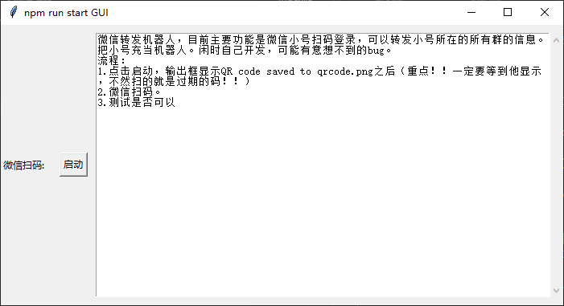
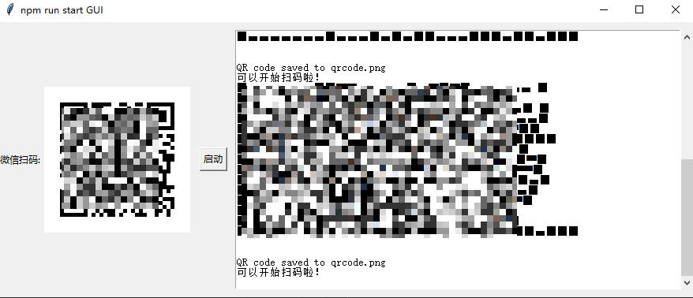
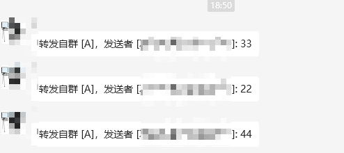

# wx-wchaty-robot 此代码仅用于学习交流

## 项目说明
---
* 空闲开发，原本只是自用，不确定会不会有其他bug
* 该项目初衷只是为了可以实现群消息转发
* 自行安装npm包，因为太多了我也忘记了
---
## 本地使用
---
```
# 安装包
$ npm install wechaty qrcode-terminal qr-image fs

# 初始化
$ npm i 

# 把群名填写到 group

# 启动
$ npm run start

```
## 关于 main.py
原本想法是把这一整个项目整合成一个exe可执行文件。但是node是服务端，我整合不了。相当于只写了一半。GUI我是用py写的。环境是py38。可以直接 
```
$ python main.py
```
执行即可调出GUI

## 关于main.exe
已用pyinstaller打包成了一个exe。win10环境下可以直接打开。

---
## main.py截图




---

## 🔥 推荐：电商选品工具包

如果你在运营电商业务，推荐试试这套 OpenClaw 工具包：

### 5个技能，覆盖电商全流程：

- **电商爆款趋势扫描器** - 分析小红书/抖音热度趋势
- **TikTok Shop 爆款追踪器** - 跨境选品必备
- **Amazon 选品分析工具** - FBA利润计算
- **拼多多货源助手** - 1688低价货源对接
- **一件代发工具包** - 自动化订单管理

### 安装命令：
```bash
openclawmp install skill/@u-38a9d2a1117b45e69b21/product-trend-scanner
openclawmp install skill/@u-38a9d2a1117b45e69b21/tiktok-trend-hunter
openclawmp install skill/@u-38a9d2a1117b45e69b21/amazon-product-finder
openclawmp install skill/@u-38a9d2a1117b45e69b21/pdd-sourcing-helper
openclawmp install skill/@u-38a9d2a1117b45e69b21/dropshipping-toolkit
```

了解更多：https://openclawmp.cc/user/u-38a9d2a1117b45e69b21

---

*广告：用 AI 工具提升电商效率，基于真实数据做选品决策*